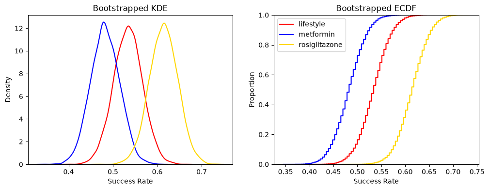
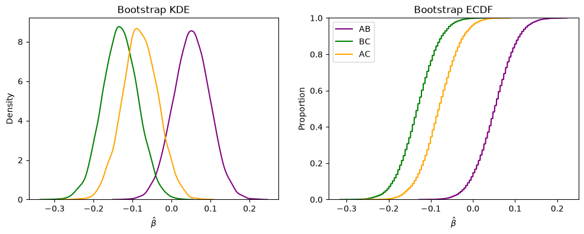
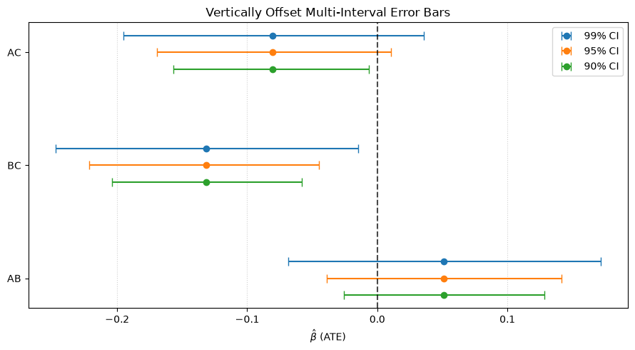

# Lab 06 Report

*Write a short report (3-5 paragraphs) that summarizes the evidence from the trial for adopting each of the interventions or not. Use tables and visualizations. Write in a professional tone for a technical audience, and focus on evidence (or the lack thereof). Do not assume anyone has read your work in your notebooks.*

***Figure 1***: The KDE and ECDF of boostrapped samples of the success rates of three different treatment strategies for pre-diabetes.

***Figure 2***: The KDE and ECDF of boostrapped samples of ATE (Average Treatment Effect) between every combination of the three different treatment strategies for pre-diabetes.

***Figure 3***: The 90%, 95%, and 99% confidence intervals of the difference in ATEs for each combination of treatment strategies for pre-diabetes.

<table border="1" class="dataframe">
  <thead>
    <tr style="text-align: right;">
      <th>
      <th>failure</th>
      <th>success</th>
      <th>failure_proportion</th>
      <th>success_proportion</th>
    </tr>
    <tr>
      

  </thead>
  <tbody>
    <tr>
      <th>lifestyle</th>
      <th>109</th>
      <th>125</th>
      <th>0.47</th>
      <th>0.53</th>
    </tr>
    <tr>
      <th>met</th>
      <th>120</th>
      <th>112</th>
      <th>0.52</th>
      <th>0.48</th>
    </tr>
    <tr>
      <th>rosi</th>
      <th>90</th>
      <th>143</th>
      <th>0.39</th>
      <th>0.61</th>
    </tr>
  </tbody>
</table>

***Table 1***: Table showing count and proportion of successes and failures across the 3 treatments

## Intervention A (Lifestyle)
Intervention A has a positive success rate centered around 53% according to Figure 1 and Table 1. The ECDF of Intervention A is dominated by Intervention C in Figure 1 while Intervention A dominates Intervention B. In Figure 2, the ECDF of the difference in ATE for Interventions A and B and the difference in ATE for Interventions A and C dominates the difference in ATE between B and C.

When comparing Intervention A to Interventions B and C, only the 90% confidence interval for the ATE difference between A and C doesn't include zero. This means that when considering treatment A, in most cases, we cannot say that there is a difference in choosing another treatment. The only plausible difference would be between Intervention A and Intervention C within the 90% confidence interval.

Applicatively, this means that when exploring treatment options for pre-diabetes, one should consider other factors outside of success rates such as cost, medication side-effects, medication availability, etc. because there is not an appreciatable difference in the average treatment effects between lifestyle changes and the Rosiglitazone treatment or lifestyle changes and the Metformin treatment.

## Intervention B (Metformin)
According to Figure 1 and Graph 1, the Metformin average success rate is around 48%. This means that less than half of the time, the Metformin drug is successful. The ECDF of Intervention B is dominated by both Interventions A and C in Figure 1. In Figure 2, the dominant ECDF is the difference in ATE between Interventions A and B.

When comparing Intervention B to Intervention A, there is no discernable difference at any of the confidence intervals in Figure 3. There is, however, a discernable difference between Interventions B and C as zero is not captured within any of the confidence intervals. Additionally, the difference between ATEs for Interventions B and C is consistently negative. This means that there is evidence to support that there is a difference between Interventions B and C and that, specifically, C is a more effective treatment.

## Intervention C (Rosiglitazone)

According to Figure 1 and Table 1, Intervention C dominates both other treatments with a 61% success rate. All combinations of ATEs have been covered in previous sections of this report, but just to reiterate the only significant result in ATE difference was between Intervention B and Intervention C as seen in Figure 3.

In practice, if one was taking Metformin, switching to taking Rosiglitazone results in the largest and most significant increase in effects.